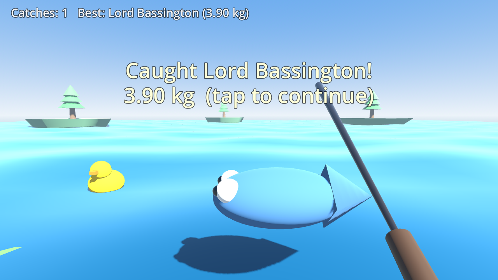

# Lazy Lake 🎣

A calm, funny, low-poly **first-person fishing game** for mobile, made in
**Godot 4.3**. Cast off a little island, wait for a bite, tap to hook, then reel
your goofy catch in while keeping the line from snapping.

Everything — the island, animated water, the rod, the fish, and all the sound
effects — is generated in code from simple shapes and sine-wave shaders, so
there are no art or audio files to manage.



## How to play

- **Cast** — hold the big button (bottom-right) to charge, release to fling the bobber out. Longer hold = farther cast.
- **Bite** — when you see **TAP!**, tap anywhere fast to hook the fish.
- **Reel** — hold the button to reel in. Watch the **tension** bar: reel in bursts and let go when it gets near the red, or the line snaps.
- Land it and your catch pops up with its name and weight. Beat your best!

On desktop the mouse acts as touch, so you can play it in the editor too.

## Run it on a computer

1. Install [Godot 4.3](https://godotengine.org/download) (the normal version, not .NET).
2. Open Godot → **Import** → pick this `fishing/` folder's `project.godot`.
3. Press **Play** (▶). Click-and-hold acts as the touch controls.

## Build it for your phone (Android)

**Easiest (in the Godot editor):**
1. In Godot: **Editor → Manage Export Templates → Download and Install**.
2. **Project → Export → Add… → Android**, then **Export Project** to get an `.apk`.
3. Copy the `.apk` to your phone and open it (allow "install from this source").

Godot's docs walk through the one-time Android SDK setup:
<https://docs.godotengine.org/en/4.3/tutorials/export/exporting_for_android.html>

**Automated (GitHub Actions):** the workflow at
`.github/workflows/fishing-apk.yml` builds an APK you can download from the
run's Artifacts. Trigger it from the repo's **Actions** tab → *Build Lazy Lake
APK* → **Run workflow**.

## Play-test it headlessly (no screen)

`tools/play.sh` imports the project and runs it under a virtual display with
software OpenGL. The game's `--autotest` mode plays real casts with synthetic
touch input, saves a screenshot, and prints the result — this is how the game
is checked on a server with no GPU.

```bash
GODOT=/path/to/Godot_v4.3-stable_linux.x86_64 fishing/tools/play.sh 1600 shot.png
```

## Files

| File | What it is |
| --- | --- |
| `game.gd` | The whole game: world, rod, cast/bite/reel loop, fish, state machine |
| `hud.gd` | Touch controls, meters, messages |
| `water.gdshader` | Animated low-poly water (its wave formula is mirrored in `game.gd` so the bobber floats correctly) |
| `sfx.gd` | Procedurally generated sound effects |
| `tools/play.sh` | Headless play-test + screenshot harness |
